<p align="center">
  <a href="#readme">
     — One Repo, Many Agents, One Memory" width="100%">
  </a>
</p>

<p align="center">
  <strong>Shared FalkorDB Property Graph for Autonomous Coding Agents &amp; Trust Enforcement</strong>
</p>

<p align="center">
  <a href="https://www.falkordb.com/"></a>
  <a href="#"></a>
  <a href="#"></a>
  <a href="https://threejs.org/"></a>
</p>

---

## Overview

When multiple AI coding agents collaborate on the same codebase—Claude Code fixing bugs, a fast model drafting tests, subagents debugging fixtures—each agent transition risks losing critical reasoning traces. Even worse, shared context can propagate hallucinations and dead-end fixes to downstream agents.

**Sheldon** solves this by establishing a single, shared [FalkorDB](https://www.falkordb.com/) property graph per repository. It provides **memory that can refuse untrusted writes**:

- **⚡ Lease-Based Coordination:** Tasks are claimed with atomic conditional writes and heartbeats. No race conditions, no dual-assignment.
- **🛡️ Evidence Gates:** Models can cite evidence, but only verifiable runs (`sheldon run` exit codes, CI webhooks) can generate it.
- **🚫 Automated Retry Suppression:** Preflight fingerprinting checks proposed actions against refuted attempts in the graph. If Agent A tried a broken fix last week, Agent B is prevented from repeating it today.
- **🔗 Causal Traceability:** Every Claim, Evidence, Approval, and Task records the exact model, session, and timestamp that produced it.

---

## Visual Explorable & Interactive Blog

The accompanying interactive technical essay and 3D WebGL diorama explores the mechanics of trust enforcement in shared agent memory:

- **Section 01: Introduction & The Repo Problem:** Architectural perspective on multi-agent collaboration.
- **Section 02: The Shared Notebook & The Catch:** Property graph topologies and mistake cascades.
- **Section 03: Three Enforcement Mechanisms:** Deep dive into retry blockers and Cypher approval gates.
- **Section 04: Interactive WebGL Dioramas:** Real-time 3D property graph and propagation simulators.
- **Section 05: Synthesis & Benchmarks:** Quantitative analysis of token savings and repeat-error elimination.

---

## Quick Start

Run the interactive explorable blog locally:

```bash
# Clone the repository
git clone https://github.com/Satyanshgaur/sheldon-blog.git
cd sheldon-blog

# Install dependencies
npm install

# Start Vite development server
npm run dev
```

Build for production:

```bash
npm run build
```

---

## Assets

- [`sheldon-banner.svg`](./sheldon-banner.svg): Master hero screen banner with the `SHELDON>` prompt formed by joining vertices $v_1$ (Claim), $v_2$ (Action), and $v_3$ (Evidence).
- [`sheldon-logo.svg`](./sheldon-logo.svg): Compact standalone `SHELDON>` wordmark and vertex chevron.

---

<p align="center">
  Built for <strong>Graph Hacks</strong> (WeMakeDevs × FalkorDB) • Track 02: Agent Memory &amp; Coordination
</p>
